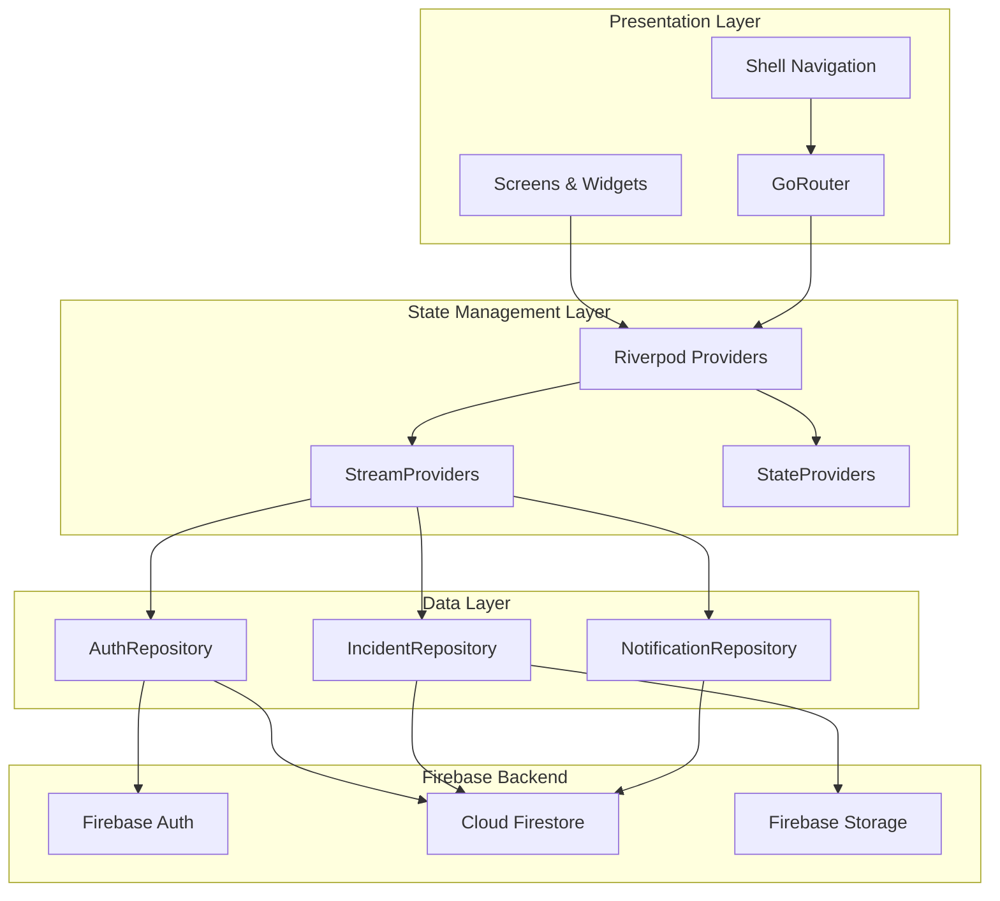

# Architecture Diagram

## Layer Responsibilities

| Layer | Responsibility |
|-------|---------------|
| **Presentation** | UI widgets, screens, navigation shell, route configuration |
| **State Management** | Riverpod providers exposing reactive Firestore streams and local state |
| **Data** | Repository classes wrapping Firebase SDK calls, model serialization |
| **Firebase** | Authentication, real-time database, file storage |

## Data Flow

1. User interacts with a screen widget
2. Widget reads from a Riverpod provider (StreamProvider for real-time data)
3. Provider delegates to a Repository
4. Repository calls Firebase SDK
5. Firestore streams propagate changes back through the provider chain
6. UI rebuilds automatically via Riverpod's reactive rebuild
