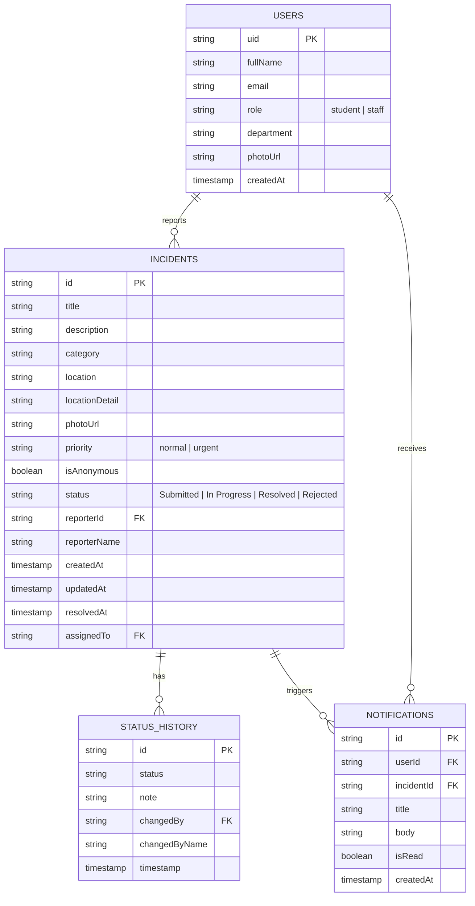

# Firestore Data Model Diagram

## Collections

| Collection | Description | Key Indexes |
|-----------|-------------|-------------|
| `users/{uid}` | User profiles | — |
| `incidents/{id}` | Incident reports | `reporterId` + `createdAt` desc, `createdAt` desc |
| `incidents/{id}/statusHistory/{entryId}` | Status change audit trail | `timestamp` asc |
| `notifications/{id}` | In-app notifications | `userId` + `createdAt` desc, `userId` + `isRead` |
