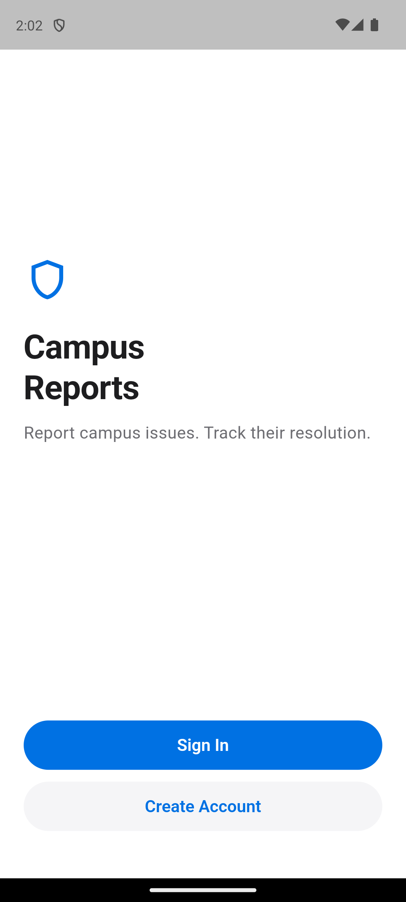
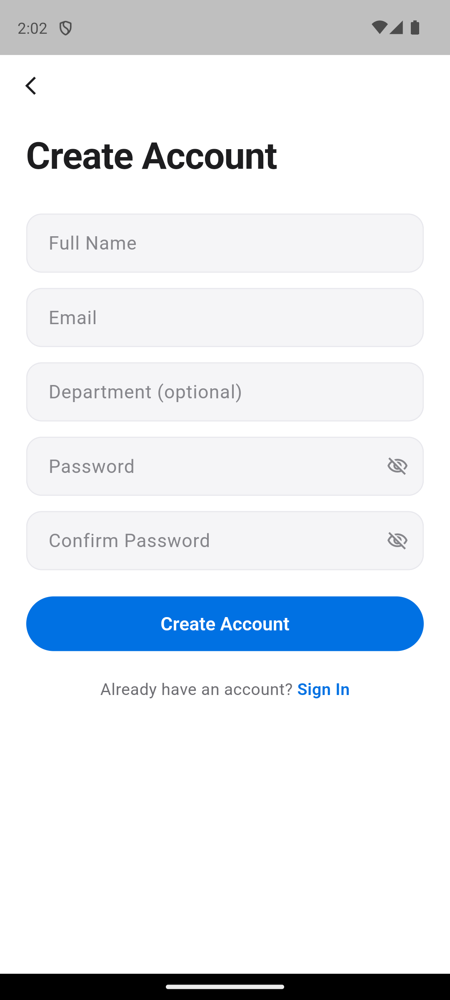
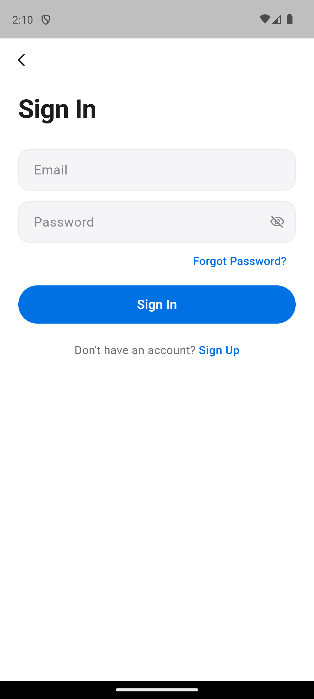

# Campus Reports: A Mobile Incident Reporting System for African Leadership University

**Nkem Jeferson Achia**
African Leadership University
j.nkem@alustudent.com

---

## Abstract

This report presents the design, implementation, and evaluation of Campus Reports, a cross-platform mobile application developed using the Flutter framework and Firebase backend services. The application enables students at African Leadership University (ALU) to report campus infrastructure incidents — such as broken facilities, water shortages, and electricity outages — and enables staff to manage, triage, and resolve these reports in real time. This document details the application architecture, Firebase data structure, state management approach using Riverpod, role-based access control, UI/UX design decisions, testing strategy, challenges encountered during development, and lessons learned. The system demonstrates effective use of reactive programming patterns, declarative navigation, and server-side security enforcement in a modern mobile application context.

---

## I. Introduction

Campus infrastructure management at African Leadership University requires a reliable communication channel between students experiencing issues and the facilities staff responsible for resolving them. Traditional approaches — verbal reports, email threads, or group chats — lack traceability, accountability, and real-time status tracking. Campus Reports addresses these shortcomings by providing a structured, role-based mobile application where incidents are reported, categorized, tracked through a defined lifecycle, and resolved with full audit trails.

The application was developed as part of the ALU Mobile Application Development course, with the objective of demonstrating proficiency in Flutter widget composition, Firebase integration, asynchronous data handling, state management, navigation, form validation, and UI/UX design.

**Key requirements include:**
- Student registration restricted to ALU email domains (`@alustudent.com`, `@alueducation.com`)
- Email verification before access is granted
- Incident submission with category, location, priority, description, and optional photo evidence
- Real-time status tracking with an audit trail
- Role-based dashboards for students and staff
- In-app notifications when incident status changes
- Secure, server-enforced access control

---

## II. Application Architecture

### A. Architectural Pattern

Campus Reports follows a **feature-first clean architecture** organized into four layers: Presentation, State Management, Data, and Backend. This layering enforces separation of concerns and ensures that UI code never directly accesses Firebase SDKs [1].

```
┌─────────────────────────────────────────────┐
│           Presentation Layer                │
│  Screens, Widgets, GoRouter, Shell Nav      │
├─────────────────────────────────────────────┤
│         State Management Layer              │
│  Riverpod Providers (Stream, State, Family) │
├─────────────────────────────────────────────┤
│              Data Layer                     │
│  AuthRepository, IncidentRepository,        │
│  NotificationRepository, Models             │
├─────────────────────────────────────────────┤
│           Firebase Backend                  │
│  Firebase Auth, Cloud Firestore, Storage    │
└─────────────────────────────────────────────┘
```

**Fig. 1.** Four-layer application architecture.

Each layer has a single responsibility:
- **Presentation**: UI widgets, screen layouts, navigation configuration, and the tab bar shell.
- **State Management**: Riverpod providers that expose reactive Firestore streams and local UI state to the presentation layer.
- **Data**: Repository classes encapsulating all Firebase SDK interactions, plus Dart model classes with Firestore serialization.
- **Backend**: Firebase Auth for authentication, Cloud Firestore for structured data, and Firebase Storage for photo uploads.

### B. Folder Structure

The project uses a feature-first organization:

```
lib/
├── core/
│   ├── constants/      # App-wide constants (domains, categories, locations)
│   ├── providers/      # Cross-cutting providers (theme)
│   ├── theme/          # Colors, typography, spacing, shadows, breakpoints
│   ├── utils/          # Validators, helpers, extensions
│   └── widgets/        # 22 reusable UI components
├── features/
│   ├── auth/
│   │   ├── data/       # UserModel, AuthRepository
│   │   └── presentation/ # Welcome, Login, Register, Verify, ForgotPassword
│   ├── incidents/
│   │   ├── data/       # IncidentModel, StatusHistoryModel, IncidentRepository,
│   │   │               # IncidentFilter, ReportStats
│   │   └── presentation/ # Home, Reports, NewReport, Detail, Filter, Location
│   ├── notifications/
│   │   ├── data/       # NotificationModel, NotificationRepository
│   │   └── presentation/ # NotificationsScreen
│   ├── profile/
│   │   └── presentation/ # ProfileScreen
│   └── staff/
│       └── presentation/ # StaffDashboardScreen
├── routing/            # GoRouter config, StudentShell, StaffShell
├── main.dart           # App entry point
└── firebase_options.dart
```

**Fig. 2.** Feature-first directory structure.

This organization ensures that all code related to a feature (data models, repositories, and screens) resides in the same directory, improving navigability and reducing coupling between features [2].

### C. Data Flow

1. User interacts with a screen widget (e.g., taps "Submit Report").
2. Widget invokes a method on a repository via a Riverpod provider.
3. Repository calls the Firebase SDK (e.g., `Firestore.collection('incidents').add()`).
4. Firestore emits a snapshot update through its real-time stream.
5. The corresponding `StreamProvider` receives the update.
6. Riverpod's dependency tracking triggers a rebuild of all widgets consuming that provider.
7. The UI reflects the change without manual refresh logic.

This unidirectional data flow ensures consistency: the Firestore database is the single source of truth, and all screens derive their state from it reactively [3].

---

## III. Firebase Data Structure

### A. Collections

The Firestore database comprises three top-level collections and one sub-collection:

**Table I: Firestore Collections**

| Collection | Document ID | Description |
|---|---|---|
| `users` | Firebase Auth UID | User profiles (name, email, role, department) |
| `incidents` | Auto-generated | Incident reports with metadata |
| `incidents/{id}/statusHistory` | Auto-generated | Audit trail of status changes |
| `notifications` | Auto-generated | In-app notifications per user |

### B. Entity-Relationship Model

```
┌──────────┐       reports        ┌────────────┐
│  USERS   │──────────────────────│ INCIDENTS  │
│          │  1                 * │            │
│ uid (PK) │                      │ id (PK)    │
│ fullName │                      │ title      │
│ email    │                      │ description│
│ role     │                      │ category   │
│ department│                     │ location   │
│ createdAt│                      │ priority   │
└──────────┘                      │ status     │
     │                            │ reporterId │
     │ receives                   │ photoUrl   │
     │                            │ isAnonymous│
     ▼                            │ createdAt  │
┌──────────────┐                  │ updatedAt  │
│NOTIFICATIONS │                  │ resolvedAt │
│              │                  │ assignedTo │
│ id (PK)      │                  └────────────┘
│ userId (FK)  │                        │ has
│ incidentId   │                        │
│ title        │                        ▼
│ body         │                ┌───────────────┐
│ isRead       │                │STATUS_HISTORY │
│ createdAt    │                │               │
└──────────────┘                │ id (PK)       │
                                │ status        │
                                │ note          │
                                │ changedBy     │
                                │ changedByName │
                                │ timestamp     │
                                └───────────────┘
```

**Fig. 3.** Entity-relationship diagram of the Firestore data model.

### C. Design Rationale

Firestore's document-oriented, NoSQL structure was chosen over a relational database for several reasons:
1. **Real-time synchronization**: Firestore provides native real-time listeners (`snapshots()`), eliminating the need for polling or WebSocket infrastructure [4].
2. **Offline persistence**: Firestore caches documents locally, allowing the app to function on unreliable campus networks.
3. **Scalability**: Firestore auto-scales without manual database provisioning.

The `statusHistory` sub-collection was modeled as a sub-collection rather than an embedded array to allow independent querying, ordering by timestamp, and avoiding document size growth as incidents accumulate history entries [5].

---

## IV. State Management

### A. Riverpod Provider Architecture

The application uses **Riverpod** (version 2.x) as its state management solution. Riverpod was chosen over alternatives (Provider, BLoC, GetX) for three key reasons:

1. **Compile-time safety**: Providers are declared as global variables with typed return values. Accessing a non-existent provider produces a compile-time error, unlike Provider's runtime `ProviderNotFoundException` [6].
2. **Automatic disposal**: Riverpod disposes resources when no widget references them, preventing memory leaks from unclosed Firestore streams.
3. **Natural fit with Firestore streams**: `StreamProvider` directly maps to Firestore's `snapshots()` API, converting real-time database updates into reactive UI state with minimal boilerplate.

### B. Provider Hierarchy

```
authStateProvider (StreamProvider<User?>)
        │
        ▼
currentUserProvider (StreamProvider<UserModel?>)
        │
        ├──▶ routerProvider (Provider<GoRouter>)
        │         └──▶ redirect logic (auth + role guards)
        │
        ├──▶ allIncidentsProvider (StreamProvider<List<IncidentModel>>)
        ├──▶ userIncidentsProvider (StreamProvider<List<IncidentModel>>)
        ├──▶ incidentDetailProvider (StreamProvider.family<IncidentModel?, String>)
        ├──▶ statusHistoryProvider (StreamProvider.family)
        ├──▶ notificationsProvider (StreamProvider<List<NotificationModel>>)
        └──▶ unreadNotificationCountProvider (StreamProvider<int>)
```

**Fig. 4.** Riverpod provider dependency graph.

The `authStateProvider` sits at the root of the dependency tree. When Firebase Auth emits a state change (login, logout, token refresh), all dependent providers — user profile, incidents, notifications, and the router — automatically re-evaluate. This cascading reactivity eliminates manual state synchronization between features [3].

### C. Comparison with Alternatives

**Table II: State Management Comparison**

| Criterion | Riverpod | BLoC | Provider |
|---|---|---|---|
| Boilerplate per feature | Low (1 provider declaration) | High (Event, State, Bloc classes) | Medium |
| Compile-time safety | Yes | Partial | No |
| Stream support | Native `StreamProvider` | `BlocBuilder` + `StreamSubscription` | `StreamProvider` |
| Testability | Excellent (override any provider) | Good | Good |
| Automatic disposal | Yes | Manual `close()` | Context-dependent |
| Learning curve | Moderate | Steep | Low |

---

## V. User Roles and Access Control

### A. Role Definitions

The application defines two roles:
- **Student**: Self-registers with an ALU email address. Can create, view, edit (while status is "Submitted"), and delete their own reports.
- **Staff**: Role is assigned by updating the `role` field in the Firestore Console. Can view all reports, update incident statuses, add notes, and view reporter identities on anonymous reports.

### B. Access Control Implementation

Access control is enforced at two independent layers, following the defense-in-depth principle [7]:

**1. UI Layer (Client-Side)**
- GoRouter's `redirect` callback evaluates auth state, email verification, and role on every navigation event.
- Students attempting to access `/staff/*` routes are redirected to `/home`; staff attempting `/home` are redirected to `/staff`.
- Staff-only UI controls (status update buttons, assignment dropdowns) are conditionally rendered based on `user.isStaff`.

**2. Backend Layer (Firestore Security Rules)**
```
function isStaff() {
  return isAuthenticated() &&
    get(/databases/$(database)/documents/users/$(request.auth.uid))
      .data.role == 'staff';
}
```

Key rule enforcement:
- All reads require `request.auth != null && request.auth.token.email_verified`.
- Incident creation validates `request.resource.data.reporterId == request.auth.uid` and enforces field constraints (title length 5-80 chars, description >= 20 chars).
- Status updates require `isStaff()`.
- Users cannot modify their own `role` field: `!request.resource.data.diff(resource.data).affectedKeys().hasAny(['role'])`.
- Storage uploads are scoped to the user's own path with a 5 MB and image-type restriction.

**Table III: Permission Matrix**

| Action | Student | Staff | Rule Enforcement |
|---|---|---|---|
| Register / Login | Yes | Yes | Firebase Auth |
| View all incidents | Yes | Yes | `isAuthenticated()` |
| Create incident | Yes | Yes | `reporterId == auth.uid` + `isValidIncident()` |
| Edit own report (Submitted) | Yes | Yes | `reporterId == auth.uid && status == 'Submitted'` |
| Delete own report (Submitted) | Yes | Yes | `reporterId == auth.uid && status == 'Submitted'` |
| Update incident status | No | Yes | `isStaff()` |
| Create notification | No | Yes | `isStaff()` |
| Read notifications | Own only | Own only | `resource.data.userId == auth.uid` |
| Upload photo | Own folder | Own folder | `auth.uid == userId` path check |

---

## VI. UI/UX Design Decisions

### A. Application Screenshots

The following screenshots demonstrate the implemented UI:

| Screen | Description |
|--------|-------------|
|  | **Welcome Screen**: Clean, spacious layout with shield icon, app branding, and two CTAs (Sign In, Create Account). Blue accent color on white background. |
|  | **Registration Screen**: Form with Full Name, Email, Department (optional), Password, and Confirm Password fields. Apple-style rounded text fields with 14px border radius. Password visibility toggles. Blue "Create Account" button with "Sign In" navigation link. |
|  | **Login Screen**: Minimal sign-in form with Email and Password fields, password visibility toggle, "Forgot Password?" link, blue "Sign In" button, and "Don't have an account? Sign Up" navigation. Back arrow for returning to Welcome. |

**Fig. 5.** Application screenshots showing the Welcome, Registration, and Login workflows.

### B. Design Philosophy

The UI is inspired by Apple's Human Interface Guidelines and the apple.com design language: calm, spacious, confident, and precise [8]. This approach was chosen to produce a distinctive, professional interface that differentiates the application from generic Material Design defaults.

**Key design principles:**
- **No purple, no gradients**: The default Material purple was replaced with a blue accent (`#0071E3` light, `#2997FF` dark) consistent with Apple's design language.
- **Monochrome hierarchy**: Three levels of text color (primary, secondary, tertiary) create visual hierarchy without color overload.
- **Hairline borders over shadows**: Cards use 0.5px borders (`#E8E8ED`) rather than Material elevation shadows, creating a lighter, more modern aesthetic.
- **Generous spacing**: 24px horizontal screen padding, 12-16px component gaps, and 44px minimum touch targets ensure readability and accessibility.

### C. Color System

**Table IV: Status Color Mapping**

| Status | Color | Hex | Rationale |
|---|---|---|---|
| Submitted | Orange | `#FF9F0A` | Attention-requiring, awaiting action |
| In Progress | Blue | `#0A84FF` | Active, being worked on |
| Resolved | Green | `#30D158` | Positive outcome, completed |
| Rejected | Gray | `#8E8E93` | Inactive, no further action |

Both light and dark mode are fully supported. The application respects the system theme by default (`ThemeMode.system`) and allows manual toggling via the Profile screen.

### D. Component Library

The application includes 22 custom reusable widgets:

**Table V: Key Custom Components**

| Component | Purpose | Design Details |
|---|---|---|
| `AppleButton` | Primary action button | Full-width pill, 50px height, 0.97 press scale animation |
| `AppleTextField` | Form input | Rounded rect (r=14), filled background, 1px focus border |
| `IncidentCard` | Report list item | Status dot, category icon, relative time, priority indicator |
| `StatusDot` | Status indicator | 8px colored dot with status label |
| `InsetGroupedSection` | Settings-style grouping | iOS-style inset grouped list section |
| `ShimmerLoading` | Loading placeholder | Animated gradient shimmer while data loads |
| `FadeInItem` | List animation | Staggered fade-in for list items |
| `FilterSheet` | Report filtering | Bottom sheet with status and category chips |

### E. Navigation Design

Navigation uses `go_router` with `ShellRoute` to provide separate tab bar shells for students (Home, Reports, Notifications, Profile) and staff (Dashboard, Reports, Notifications, Profile). The `NewReportScreen` and `IncidentDetailScreen` are presented as full-screen routes outside the shell, with a custom slide-up transition for the report form:

```dart
transitionsBuilder: (_, animation, _, child) {
  return SlideTransition(
    position: Tween<Offset>(
      begin: const Offset(0, 1),
      end: Offset.zero,
    ).animate(CurvedAnimation(
      parent: animation,
      curve: Curves.easeOutCubic,
    )),
    child: child,
  );
}
```

This mirrors iOS's modal presentation pattern, providing a familiar feel for mobile users [8].

---

## VII. Testing Strategy

### A. Testing Layers

The testing strategy covers three layers:

**1. Unit Tests** — Pure Dart functions tested in isolation:
- `validators_test.dart`: Email domain validation (ALU-only), password strength (minimum 8 characters, uppercase, digit), name length bounds, incident title/description constraints.
- `priority_helpers_test.dart`: Priority-to-color mapping, label formatting, icon assignment for all four levels (Urgent, High, Normal, Low).
- `status_helpers_test.dart`: Status-to-color mapping using named `AppColors` constants, display name formatting, icon assignment.
- `string_extensions_test.dart`: `capitalize`, `initials`, `truncate`, `wordCount`, `isValidUrl`.
- `date_extensions_test.dart`: `isToday`, `isYesterday`, `isThisWeek`, `smartDate`, `shortDate`, `fullDate` formatting.
- `incident_filter_test.dart`: `copyWith`, `clear`, `hasActiveFilters` on the `IncidentFilter` model.
- `report_stats_test.dart`: Aggregation of `ReportStats` from an incident list.
- `image_picker_helper_test.dart`: Verification of image size and quality constants.

**2. Widget Tests** — Flutter widget tree verification:
- Login and register forms: error message rendering for invalid input, button state during loading.
- New report form: category selection interaction, required field validation, character counter behavior.

**3. Integration Tests** — End-to-end flow verification:
- Auth flow: Register → email verification → login → redirect to role-appropriate shell.
- Report lifecycle: Create → list appearance → detail view → staff status update → notification delivery.
- Role-based routing: Students blocked from staff routes and vice versa.

### B. Test Execution

```bash
flutter test
```

### C. Manual Testing Checklist

| Test Case | Expected Result |
|---|---|
| Register with ALU email | Account created, verification email sent |
| Register with non-ALU email | Validation error: "Only ALU email addresses are allowed" |
| Login with unverified email | Redirect to verification screen |
| Submit incident with photo | Report appears in list with photo thumbnail |
| Staff updates status | Student receives notification, timeline updates |
| Dark mode toggle | All screens render correctly in dark theme |
| Pull-to-refresh on reports | List updates with latest data |
| Offline mode | Cached data displayed, operations queued |

---

## VIII. Challenges Encountered and Solutions

### A. Email Verification Flow

**Challenge**: Firebase Auth's `emailVerified` property does not update in real time. The `authStateChanges` stream does not re-emit after the user clicks the verification link in their email.

**Solution**: Implemented an "I've Verified My Email" button on the `VerifyEmailScreen` that calls `user.reload()` followed by invalidating the `authStateProvider`. This forces the router's redirect logic to re-evaluate, advancing the user to the appropriate dashboard [4].

### B. Role-Based Routing with Asynchronous User Data

**Challenge**: GoRouter's `redirect` function executes synchronously during navigation, but the user's role is stored in Firestore and loaded asynchronously. On cold start, the user profile may not be available when the first redirect fires.

**Solution**: The `routerProvider` watches both `authStateProvider` and `currentUserProvider`. When user data arrives from Firestore, Riverpod triggers a provider rebuild, which causes GoRouter to recalculate its redirect and navigate to the correct shell. During the loading window, the app remains on the current route (typically the splash/welcome screen) [6].

### C. Atomic Status Updates with Notifications

**Challenge**: Updating an incident's status involves three writes: (1) update the incident document, (2) add a status history entry, and (3) create a notification. If any write fails independently, the data becomes inconsistent.

**Solution**: Used Firestore's `WriteBatch` to perform all three operations atomically:

```dart
final batch = _firestore.batch();
batch.update(docRef, {'status': newStatus, 'updatedAt': now});
batch.set(historyRef, statusEntry.toMap());
batch.set(notifRef, notificationData);
await batch.commit();
```

This ensures that either all three documents are written or none are, maintaining data consistency [5].

### D. Image Upload Size Management

**Challenge**: Camera images from modern smartphones can exceed 10 MB, leading to slow uploads over campus Wi-Fi and high Firebase Storage costs.

**Solution**: Applied a multi-layer compression strategy:
1. **Capture-time compression**: `image_picker`'s `maxWidth` (1024px), `maxHeight` (1024px), and `imageQuality` (80%) parameters.
2. **Client-side validation**: Check file size against `AppConstants.maxImageSizeBytes` (5 MB) before uploading.
3. **Server-side enforcement**: Firebase Storage rules reject files exceeding 5 MB: `request.resource.size < 5 * 1024 * 1024`.

### E. Android Emulator Rendering (Impeller)

**Challenge**: The application rendered a black screen on the Android emulator despite successful compilation.

**Solution**: Disabled the Impeller rendering engine, which has known compatibility issues with certain emulator GPU configurations: `flutter run --no-enable-impeller`. Skia (the legacy renderer) was used as the fallback [9].

---

## IX. Lessons Learned

1. **Firestore streams and Riverpod are synergistic**: The combination of Firestore's real-time `snapshots()` with Riverpod's `StreamProvider` creates a reactive architecture where UI updates propagate automatically from database changes with minimal glue code. This eliminated an entire class of bugs related to stale UI state.

2. **Server-side security rules are non-negotiable**: Client-side route guards and conditional rendering improve UX but provide no security. Firestore security rules are the true access control enforcement point. The investment in writing comprehensive rules with helper functions (`isAuthenticated()`, `isStaff()`, `isValidIncident()`) pays dividends in preventing unauthorized access.

3. **Feature-first organization scales**: Grouping code by feature rather than by type (all models together, all screens together) kept the codebase navigable as it grew to over 200 files. Each feature can be understood in isolation.

4. **Batch writes prevent inconsistency**: Any operation that touches multiple documents should use a `WriteBatch` or transaction. The status update flow (incident + history + notification) would be fragile without atomic batching.

5. **Design consistency compounds**: Investing early in a design system (named colors, typography scale, spacing constants, reusable components) made every subsequent screen faster to build and visually consistent. The 22-widget component library meant most screens were composed from existing pieces.

6. **Defensive validation at every boundary**: Input is validated at three levels — UI form validators (immediate feedback), repository-level checks (before Firebase calls), and Firestore security rules (server-side enforcement). This defense-in-depth approach ensures data integrity regardless of how the API is called.

---

## X. Conclusion

Campus Reports demonstrates a production-quality approach to mobile application development using Flutter and Firebase. The combination of reactive state management (Riverpod), declarative navigation (GoRouter), server-enforced security (Firestore rules), and a cohesive design system produces an application that is maintainable, secure, and user-friendly. The feature-first architecture and comprehensive testing strategy provide a foundation for future enhancements, such as push notifications via FCM, campus map integration, and analytics dashboards.

---

## References

[1] Google, "Flutter architectural overview," Flutter Documentation, 2024. [Online]. Available: https://docs.flutter.dev/resources/architectural-overview

[2] R. Martin, *Clean Architecture: A Craftsman's Guide to Software Structure and Design*. Upper Saddle River, NJ, USA: Prentice Hall, 2017.

[3] R. Pissurlenker, "Riverpod: A reactive caching and data-binding framework," Riverpod Documentation, 2024. [Online]. Available: https://riverpod.dev/docs/introduction/why_riverpod

[4] Google, "Firebase Authentication documentation," Firebase Documentation, 2024. [Online]. Available: https://firebase.google.com/docs/auth

[5] Google, "Cloud Firestore data model," Firebase Documentation, 2024. [Online]. Available: https://firebase.google.com/docs/firestore/data-model

[6] R. Pissurlenker, "Riverpod provider types," Riverpod Documentation, 2024. [Online]. Available: https://riverpod.dev/docs/concepts/providers

[7] OWASP Foundation, "OWASP Mobile Application Security Verification Standard," OWASP, 2023. [Online]. Available: https://mas.owasp.org/MASVS/

[8] Apple Inc., "Human Interface Guidelines," Apple Developer Documentation, 2024. [Online]. Available: https://developer.apple.com/design/human-interface-guidelines

[9] Google, "Impeller rendering engine," Flutter Documentation, 2024. [Online]. Available: https://docs.flutter.dev/perf/impeller
